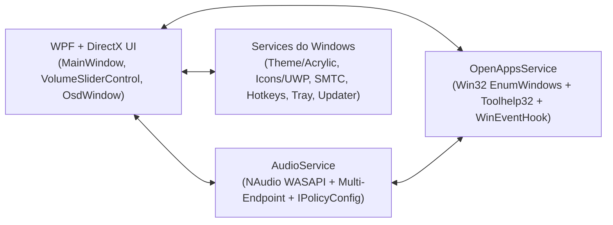

# 🎚️ Mixers — Gerenciador de Volume por Aplicativo para Windows

<div align="center">

[](https://github.com/eduardoclemes1-tech/mixers/releases/latest)
[](https://github.com/eduardoclemes1-tech/mixers/actions/workflows/build-windows.yml)
[](https://github.com/eduardoclemes1-tech/mixers/releases)
[](https://dotnet.microsoft.com/download/dotnet/8.0)
[](https://github.com/eduardoclemes1-tech/mixers/releases/latest)
[](LICENSE)

**Um mixer de volume por aplicativo 100% nativo para Windows 10 e Windows 11, feito em C# + WPF (.NET 8) com aceleração por GPU (DirectX), vidro fosco Acrylic real, integração WASAPI (NAudio) e atualização automática pelo GitHub Releases.**

</div>

---

## ⬇️ Download para Windows

Escolha a opção que preferir (os links sempre apontam para a versão mais recente):

- 👉 **[Baixar Mixers.exe (recomendado — 1 clique, executável portátil)](https://github.com/eduardoclemes1-tech/mixers/releases/latest/download/Mixers.exe)**
- 📦 **[Baixar Mixers-Windows.zip](https://github.com/eduardoclemes1-tech/mixers/releases/latest/download/Mixers-Windows.zip)**
- 📋 **[Ver todas as versões e notas (Releases)](https://github.com/eduardoclemes1-tech/mixers/releases)**

---

## ✨ Principais Recursos

- 🪟 **Visual nativo Windows 11 (Acrylic + GPU 60/144Hz):** vidro fosco real que desfoca o fundo atrás do painel, cantos retos/quadrados, opção de fundo opaco e **paleta sincronizada automaticamente com a cor de destaque do Windows ao vivo**.
- 🔄 **Todos os apps abertos em tempo real:** detecta instantaneamente aplicativos abertos (janelas da área de trabalho, apps da Microsoft Store/UWP e apps minimizados na bandeja como **Discord**, **WhatsApp**, **Spotify** e **Steam**), vincula áudio de processos WebView2/helpers ao aplicativo real e aplica **pré-volume e pré-mute síncronos** no 1º milissegundo ao tocar áudio.
- 🎧 **Trocar dispositivo de saída com 1 clique:** alterne entre fone, caixa de som e monitor/TV pelo cabeçalho ou por atalho global, com monitoramento multi-saída (`Multimedia` e `Communications`) e detecção automática de dispositivos plugados.
- 🎚️ **Sliders estilo EarTrumpet:** trilha fina de `2px` renderizada em DirectX com **medidor de pico branco ao vivo integrado**, pílula vertical slim, ajuste pela roda do mouse e menu de contexto (fixar no topo, restaurar 100% e ocultar).
- 🎨 **Ícones reais dos aplicativos:** extração em múltiplas camadas a partir de `IconPath` WASAPI, `AppxManifest.xml` (Store/UWP), `SHGetFileInfo` e `ExtractAssociatedIcon`.
- 🎙️ **Microfones, Medidor de Voz e Mute Global:** controle de ganho, mute individual, botão **`Testar`**, indicador de nível ao vivo (`Silêncio`, `Baixo`, `Ideal`, `Alto!`) e atalho global exclusivo para mutar todos os microfones.
- 🎵 **Mini controle de mídia (SMTC) & Modo Call:** exibe artista/música atual com botões `⏮ ⏯ ⏭`, abaixa música/navegadores automaticamente durante chamadas, lembra volume e mute por aplicativo e exibe OSD flutuante discreto.
- 🚀 **Bandeja inteligente & Auto-Update:** controle do volume Master rodando o scroll sobre o ícone da bandeja, ícone dinâmico para mudo de som/mic, inicialização com o Windows e atualização em 1 clique direto pelo GitHub Releases.

---

## 🏗️ Arquitetura e Tecnologias



- **Linguagem & Runtime:** C# 12 / .NET 8 (`net8.0-windows10.0.19041.0`)
- **Interface:** WPF + DirectX + DWM Acrylic Blur + WinForms NotifyIcon
- **Áudio:** [NAudio.Wasapi](https://github.com/naudio/NAudio) (`IMMNotificationClient`, `IAudioSessionNotification`, `ISimpleAudioVolume`, `IPolicyConfig`)
- **CI/CD:** GitHub Actions compila `Mixers.exe` (single-file self-contained `win-x64`) e publica automaticamente em GitHub Releases a cada tag `v*`.

---

## 📁 Estrutura do Projeto

```text
mixers/
├── .github/
│   ├── ISSUE_TEMPLATE/          # Templates de Bug Report e Feature Request
│   ├── workflows/
│   │   └── build-windows.yml    # Build e publicação automática no GitHub Releases
│   └── PULL_REQUEST_TEMPLATE.md
├── MixersWpf/
│   ├── Controls/
│   │   ├── OsdWindow.cs         # OSD flutuante de volume, mic e troca de saída
│   │   └── VolumeSliderControl.cs
│   ├── Services/
│   │   ├── AudioService.cs      # WASAPI multi-saída, pré-volume síncrono e micros
│   │   ├── HotkeyService.cs     # Atalhos globais (combinação ou tecla única)
│   │   ├── IconService.cs       # Extração de ícones Win32 + UWP AppxManifest
│   │   ├── MediaInfoService.cs  # Título da música atual (Windows SMTC)
│   │   ├── OpenAppsService.cs   # Descoberta de apps abertos e vínculo de processo-pai
│   │   ├── SettingsService.cs   # Persistência em %APPDATA%\Mixers\settings.json
│   │   ├── TrayService.cs       # Ícone dinâmico na bandeja + scroll do mouse
│   │   ├── UpdateService.cs     # Auto-update via GitHub Releases API
│   │   └── WindowsThemeService.cs
│   ├── App.xaml / App.xaml.cs
│   ├── MainWindow.xaml / MainWindow.xaml.cs
│   └── Mixers.csproj
├── Mixers.sln
├── build_windows.bat
├── CHANGELOG.md
├── CONTRIBUTING.md
├── LICENSE
└── README.md
```

---

## 🛠️ Como Compilar e Executar Localmente

### Pré-requisitos
- Windows 10 (build 19041+) ou Windows 11
- [.NET 8 SDK](https://dotnet.microsoft.com/download/dotnet/8.0)

### Comandos

```powershell
# Clonar o repositório
git clone https://github.com/eduardoclemes1-tech/mixers.git
cd mixers

# Compilar a solução
dotnet build

# Executar em modo desenvolvimento
dotnet run --project MixersWpf/Mixers.csproj
```

Para gerar o executável único portátil em `dist\Mixers.exe`:

```powershell
.\build_windows.bat
```

---

## 💡 Dicas de Uso

- **Atalho padrão:** `Ctrl+Alt+M` abre/oculta o painel (você pode personalizar para qualquer tecla ou combinação em **Ajustes**).
- **Botão direito no ícone de um app:** permite **Fixar no topo**, **Restaurar 100%** ou **Ocultar aplicativo**.
- **Roda do mouse na bandeja:** passe o cursor sobre o ícone do Mixers perto do relógio e gire o scroll para controlar o volume geral.

---

## 🤝 Contribuição

Contribuições são bem-vindas! Veja o guia em [`CONTRIBUTING.md`](CONTRIBUTING.md) e o histórico de versões em [`CHANGELOG.md`](CHANGELOG.md).

## 📄 Licença

Distribuído sob a licença **MIT**. Veja o arquivo [`LICENSE`](LICENSE) para mais detalhes.
